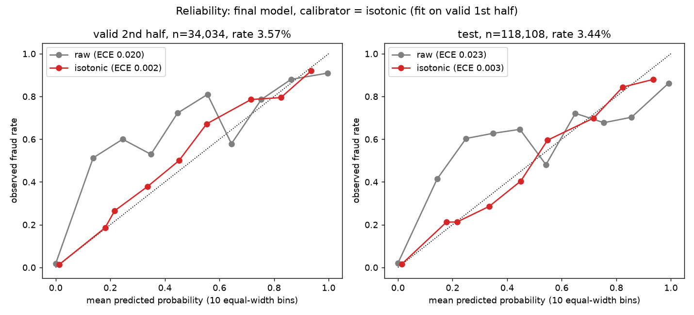
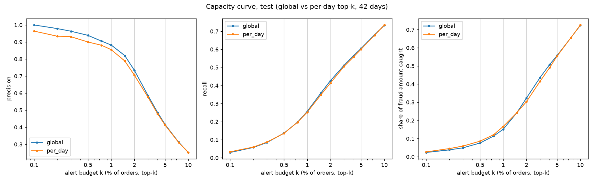
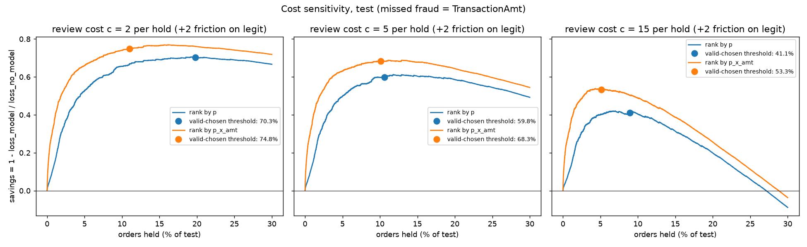
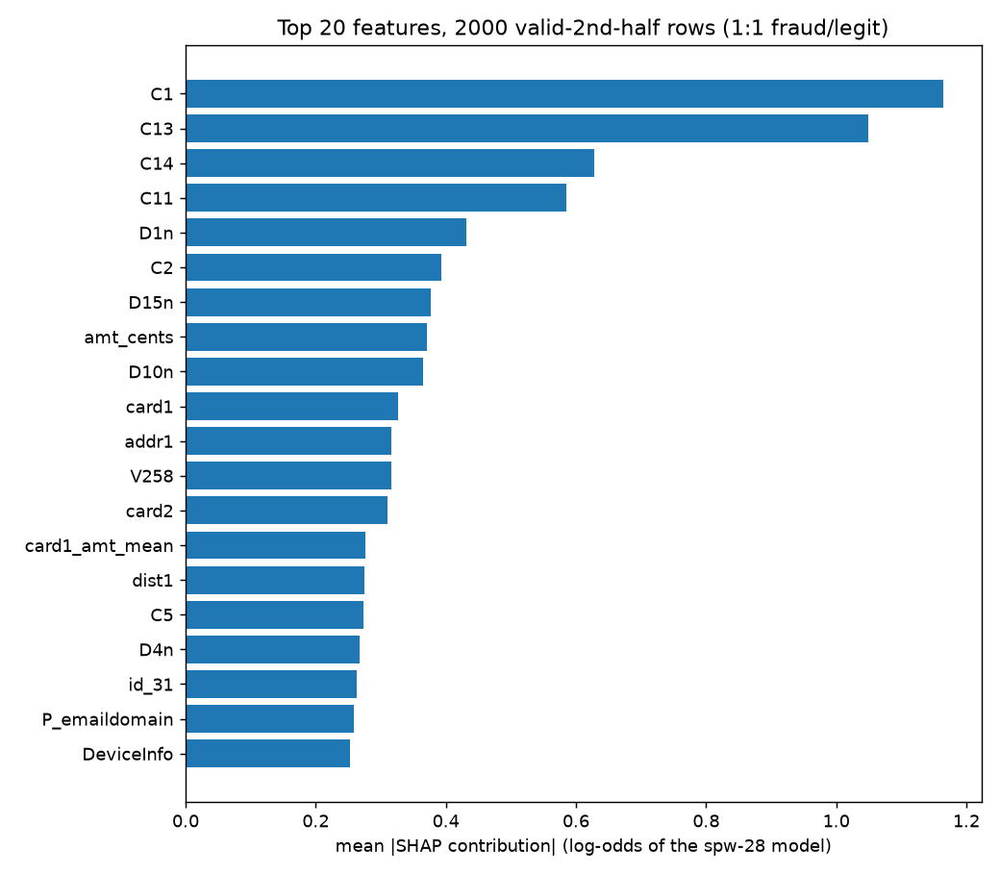

# E-Commerce Fraud Prediction

Fraud scoring for e-commerce transactions, motivated by Pickup and Return Point (PARP) abuse (customer return fraud, false "not received" claims, pickup-point partner abuse). No public labelled PARP data exists, so the models are built and evaluated on the public IEEE-CIS card-transaction fraud data with a strict time split, and the return/PARP side is written up as a design.

The final LightGBM model reaches test PR-AUC 0.5605 (95% day-block CI 0.5274-0.5903). That is +0.0373 over the raw-feature baseline (paired 95% CI 0.0274 to 0.0476). Reviewing the top 1% of orders each day catches 25.2% of fraud at 85.5% precision. Source: `results/final/metrics.json` (bootstrap, paired deltas, capacity).

## Data

A copy of the IEEE-CIS Fraud Detection competition data (Vesta) from the Kaggle dataset lnasiri007/ieeecis-fraud-detection, used for educational purposes; the data is not redistributed here.

Only `train_transaction.csv` and `train_identity.csv` (the labelled rows) are used, left-joined on `TransactionID`. Place them under `data/raw/ieee-cis/` (git-ignored) or set `IEEE_CIS_RAW_DIR`. `TransactionAmt` is treated as currency units; the real currency is not documented.

## Evaluation protocol

Split by time with `data.time_split`: train, valid, a 7-day gap (label maturity), then test. Numbers from `results/final/metrics.json` (`split`):

| Part | Days (TransactionDT // 86400) | Rows | Fraud rate |
|---|---|---|---|
| train | 1-111 | 385,712 | 0.0342 |
| valid | 111-134 | 68,067 | 0.0412 |
| gap | 7 days, dropped | - | - |
| test | 141-182 (42 days) | 118,108 | 0.0344 |

- Every choice (features, parameters, threshold, calibration) is made on valid or on forward folds, never on test.
- History features use strictly earlier rows only and no labels. There are no absolute-time features (`TransactionDT`, day index, all-time counts on low-cardinality keys).
- Seeds: LightGBM seed 42 for reported models; selection runs use 3 seeds and report mean and sd. Test CIs are day-block bootstraps (1,000 resamples over the 42 test days, seed 0).
- The test period was viewed in 3 earlier rounds (baseline_lgbm, lgbm_fe1, lgbm_fe2), each with a model fixed before viewing; the final model is the only new test view in this round.
- Reproducibility: baseline_lgbm, lgbm_fe1 and lgbm_fe2 retrain to identical best iteration and PR-AUC (243, 118, 2524; `exact: true` for all three in `results/repro/repro.json`).

## Results

Test PR-AUC and precision at top 1% for all scored models. Sources: `results/final/metrics.json` (CIs, final), `results/baseline_lgbm/metrics.json`, `results/lgbm_fe1/metrics.json`, `results/lgbm_fe2/metrics.json`, `results/baselines/metrics.json`. CIs are 95% day-block bootstrap; "-" means none was computed.

| Model | What it is | Test PR-AUC | 95% CI | Test precision at top 1% |
|---|---|---|---|---|
| final | LightGBM, 483 features, nan_keys fix, scale_pos_weight 28 | 0.5605 | 0.5274-0.5903 | 0.8824 |
| lgbm_fe2 | LightGBM + past-only history features (A_hist) | 0.5628 | 0.5293-0.5932 | 0.8883 |
| baseline_lgbm | LightGBM on raw features | 0.5232 | 0.4910-0.5544 | 0.8799 |
| lgbm_fe1 | baseline + 53 history features (incl. absolute day) | 0.5166 | 0.4838-0.5460 | 0.8756 |
| lr_raw_clip | logistic regression, clipped to train percentiles | 0.3938 | 0.3577-0.4300 | 0.7606 |
| lr_hist_clip | same with history features | 0.3849 | 0.3482-0.4196 | 0.7470 |
| lr_raw | logistic regression, unclipped | 0.1882 | - | 0.0956 |
| iforest | Isolation Forest | 0.1182 | - | 0.0000 |
| rule | velocity rule (uid count 1d, amount ratio) | 0.0776 | - | 0.1988 |

Reading:

- Final vs baseline_lgbm, paired over the same test days: PR-AUC +0.0373, 95% CI 0.0274 to 0.0476 (positive in all resamples). Precision at top 1% differs by +0.0025, CI -0.0126 to 0.0193: not distinguishable.
- Final vs lgbm_fe2: PR-AUC -0.0023, CI -0.0061 to 0.0016; precision at top 1% -0.0059, CI -0.0145 to 0.0043. Not distinguishable.
- The NaN-key fix and the class weight did not change ranking quality beyond seed noise (table below).
- Linear models are far below boosted trees. Going from fe1 to fe2 (dropping the absolute `day` feature from the history set) is where the history features start to help.

Validation-only experiments (3 seeds, mean +- sd, valid PR-AUC; no test scoring). Sources: `results/lgbm_fe2/metrics.json`, `results/lgbm_fe3_graph/metrics.json`, `results/lgbm_cw/metrics.json`.

| Candidate | Valid PR-AUC | n_features |
|---|---|---|
| A_hist (chosen in fe2) | 0.6929 +- 0.0054 | 483 |
| B_hist_uidagg | 0.6652 +- 0.0151 | 507 |
| C_uidagg | 0.6744 +- 0.0154 | 461 |
| A_hist_noall | 0.6776 +- 0.0301 | 480 |
| A_hist_noall_graph | 0.6868 +- 0.0021 | 488 |
| A_hist_nanfix | 0.6953 +- 0.0028 | 483 |
| A_hist_nanfix, spw5 | 0.6960 +- 0.0014 | 483 |
| A_hist_nanfix, spw28 (final) | 0.6961 +- 0.0014 | 483 |

All differences are within seed noise. The final configuration follows the pre-registered rule (highest mean valid PR-AUC): A_hist_nanfix with scale_pos_weight 28.

## Decision layer

Source for this section: `results/final/metrics.json` (`calibration`, `capacity`, `cost`).

Calibration: raw scores are under-confident (mean 0.0149 on test vs observed 0.0344). Isotonic regression fitted on the first half of valid was chosen over Platt scaling (valid second half: ECE 0.0022 vs 0.0040, Brier 0.0180 vs 0.0182). Test: ECE 0.0031 and Brier 0.0211 (raw: 0.0230 and 0.0236; Platt: 0.0023 and 0.0211).



Capacity: review the top k% of orders, either over the whole test period (global) or within each day (42 test days). "Fraud amount share" is the share of fraud `TransactionAmt` caught.

| k | Mode | Alerts per day | Precision | Recall | Fraud amount share |
|---|---|---|---|---|---|
| 0.5% | global | 14.1 | 0.939 | 0.137 | 0.075 |
| 0.5% | per day | 14.5 | 0.900 | 0.135 | 0.086 |
| 1% | global | 28.1 | 0.882 | 0.257 | 0.151 |
| 1% | per day | 28.6 | 0.855 | 0.252 | 0.167 |
| 2% | global | 56.3 | 0.734 | 0.427 | 0.323 |
| 2% | per day | 56.7 | 0.705 | 0.414 | 0.303 |
| 5% | global | 140.6 | 0.416 | 0.605 | 0.558 |
| 5% | per day | 141.0 | 0.413 | 0.601 | 0.555 |



Cost sensitivity: a held order costs a review fee (2, 5 or 15 currency units) and a missed fraud costs its amount. Thresholds are set on valid; the test loss is compared with holding nothing (loss 609,934). Ranking by p x amount beats ranking by p at every fee.

| Review cost | Ranking | Held share | Precision | Recall | Savings vs no model |
|---|---|---|---|---|---|
| 2 | p | 0.198 | 0.145 | 0.834 | 0.703 |
| 2 | p x amount | 0.110 | 0.206 | 0.658 | 0.748 |
| 5 | p | 0.106 | 0.240 | 0.740 | 0.598 |
| 5 | p x amount | 0.101 | 0.218 | 0.638 | 0.683 |
| 15 | p | 0.089 | 0.275 | 0.714 | 0.411 |
| 15 | p x amount | 0.051 | 0.314 | 0.467 | 0.533 |



## Explainability

Sources: `results/final/metrics.json` (`shap.top20`), `results/final/top_alerts_reasons.csv`.



Top features by mean |SHAP| (2,000 sampled rows): C1 (1.16), C13 (1.05), C14 (0.63), C11 (0.59), D1n (0.43), then C2, D15n, amt_cents, D10n, card1. The C columns are Vesta count features and the D columns are time deltas; their exact meaning is not documented.

`top_alerts_reasons.csv` lists, for each top-ranked alert, its score, calibrated probability and the top reason codes. A reason code is a feature name with its value and SHAP contribution; the first alert's reasons are C1, DeviceInfo and V45.

Governance note (not legal advice):

- The EU AI Act (Regulation (EU) 2024/1689) lists high-risk uses in Annex III. Scoring merchant payment fraud is not listed there; Recital 58 concerns fraud detection in financial services and the creditworthiness category. https://eur-lex.europa.eu/eli/reg/2024/1689/oj
- GDPR Art. 22 (https://eur-lex.europa.eu/eli/reg/2016/679/oj) and the Swiss revised FADP Art. 21 (https://www.fedlex.admin.ch/eli/cc/2022/491/en) apply to decisions based solely on automated processing with a significant effect on the person. Held orders therefore go to human review with the reason codes; the model does not auto-decline.

## Stability over time

Source: `results/backtest/metrics.json`.

Forward folds: train on days 1 to the fold's train end (the last 14 train days are used for early stopping), score the next 21 days. The raw-feature baseline and the final configuration use the same folds.

| Fold | Scored days | Train rows | Baseline PR-AUC | Final PR-AUC | Delta |
|---|---|---|---|---|---|
| 1 | 63-83 | 209,660 | 0.5613 | 0.5954 | +0.0341 |
| 2 | 87-107 | 283,222 | 0.5164 | 0.5325 | +0.0161 |
| 3 | 111-131 | 362,483 | 0.6215 | 0.6362 | +0.0147 |

The final configuration is ahead in all three folds, by a smaller margin as training data grows (no fold-level CI, so this is descriptive).

Label delay (valid PR-AUC, final configuration retrained; N = days of most recent train labels affected). Variant B marks fraud in the last N days as legit; variant A drops those rows.

| N days | B: late fraud labelled legit | A: late rows dropped |
|---|---|---|
| 0 | 0.6950 | 0.6950 |
| 7 | 0.4160 | 0.6677 |
| 14 | 0.3021 | 0.6513 |
| 30 | 0.1891 | 0.5909 |

Marking the last N days' fraud as legit (variant B) collapses valid PR-AUC (0.695 -> 0.416 at 7 days) because valid follows train without a gap and the same fraudulent clients recur, so the model learns "recent = legit"; dropping unmatured rows instead (variant A) costs much less (0.668 at 7 days). Practical rule: train only on matured labels.

## Return/PARP side: design

No public labelled PARP data exists, so this is a design, not a result.

- Label: a return or "not received" claim confirmed as abuse after investigation. Label delay is weeks, so training uses matured cases only (see label delay above).
- Scoring moment: when the return or "not received" claim is filed.
- Past-only features: customer return rate so far, days from delivery to claim, claim count in the last 30 days, pickup-point sharing counts (distinct customers per pickup point, device and address in the last 7-30 days), recipient vs buyer mismatch.
- Transfer from this repo: the `features_history.py` entity keys map to customer, pickup point, address and device keys with the same strictly-earlier windows; the graph windows (7d / 30d distinct-entity counts) become distinct customers per pickup point.

Delivery-side proxies in IEEE-CIS (`results/final/parp_signals.json`; rank 1 = most important of 483 features):

| Signal | Gain rank | SHAP rank |
|---|---|---|
| addr1 | 15 | 11 |
| dist1 | 39 | 15 |
| R_emaildomain (recipient email) | 38 | 55 |
| M3 / M4 / M5 / M6 (match flags) | 106 / 80 / 84 / 82 | 85 / 78 / 37 / 52 |
| M1 | 431 | 391 |

Address-sharing counts were tested as graph features in `results/lgbm_fe3_graph/metrics.json` (`graph_features`: addr1_nuniq_uid_7d/30d, card1_addr1_nuniq_uid_7d/30d, fp_nuniq_uid_7d/30d, uid_nuniq_fp_30d, uid_fp_component_size). A_hist_noall_graph (0.6868) did not beat A_hist (0.6929) on validation, so they are not in the final set; the addr1 entries above are history features on the card1_addr1 and uid keys plus addr1 itself.

Real-data path, not run: ASOS GraphReturns (OSF c793h, CC-BY 4.0). Its label is return, not fraud.

## Findings and limitations

- Unclipped linear models and Isolation Forest put their top 1% on an out-of-range legit cluster on days 163-173 (top-1% fraud rate 0.0948 for lr_raw, 0.0 for iforest, vs 0.7604 for lr_raw_clip; `results/baselines/diagnostics.json`). Values are clipped to the train 1st-99th percentile.
- NaN keys were lumped into one pseudo-entity in the history features; fixed via `nan_keys="nan"`, no measurable change (valid 0.6953 vs 0.6929, within seed noise).
- Prevalence shifts: fraud rate 4.12% on valid vs 3.44% on test (`results/final/metrics.json`); test PR-AUC (0.5605) is well below valid (0.6950). The calibrator is fitted on valid, so mean calibrated test probability is close but slightly low (0.0336 vs 0.0344).
- Seed noise is about 0.005-0.015 PR-AUC (sd over 3 seeds, table above); differences below that are not evidence.
- Amounts are currency units; the cost table is relative, not money.
- IEEE-CIS has no device id, so device/graph features are weak; the PARP section is a design and is not validated.
- Valid metrics for the final model use full-valid early stopping and are optimistic.

## How to run

```
pip install -r requirements.txt
export IEEE_CIS_RAW_DIR=/path/to/ieee-cis     # folder with train_transaction.csv and train_identity.csv
export MODELS_DIR=/path/to/models             # boosters and per-row scores (git-ignored)
env -u PYTHONPATH PYTHONPATH=src python -m ecommerce_fraud.baseline_lgbm   # results/baseline_lgbm
env -u PYTHONPATH PYTHONPATH=src python -m ecommerce_fraud.model_fe1       # results/lgbm_fe1
env -u PYTHONPATH PYTHONPATH=src python -m ecommerce_fraud.model_fe2       # results/lgbm_fe2
env -u PYTHONPATH PYTHONPATH=src python -m ecommerce_fraud.reproduce       # results/repro
env -u PYTHONPATH PYTHONPATH=src python -m ecommerce_fraud.baselines       # results/baselines
env -u PYTHONPATH PYTHONPATH=src python -m ecommerce_fraud.model_fe3       # results/lgbm_fe3_graph
env -u PYTHONPATH PYTHONPATH=src python -m ecommerce_fraud.model_cw        # results/lgbm_cw
env -u PYTHONPATH PYTHONPATH=src python -m ecommerce_fraud.final train     # results/final (the single new test view)
env -u PYTHONPATH PYTHONPATH=src python -m ecommerce_fraud.final analyze   # calibration, capacity, cost, SHAP, bootstrap
env -u PYTHONPATH PYTHONPATH=src python -m ecommerce_fraud.backtest        # results/backtest
```

`env -u PYTHONPATH` is only needed where the shell exports a conflicting PYTHONPATH. Training runs are heavy (up to about 10 GB RAM for LightGBM); run one at a time.

| Path | Use |
|---|---|
| `src/ecommerce_fraud/` | Python package; entry points run as `python -m ecommerce_fraud.<module>` with `PYTHONPATH=src` |
| `data/` | Raw and processed data, git-ignored |
| `models/` | Saved boosters and per-row scores, git-ignored |
| `results/` | Committed metrics, plots and run info per model |
| `AGENTS.md` | Binding rules for contributors and agents |
